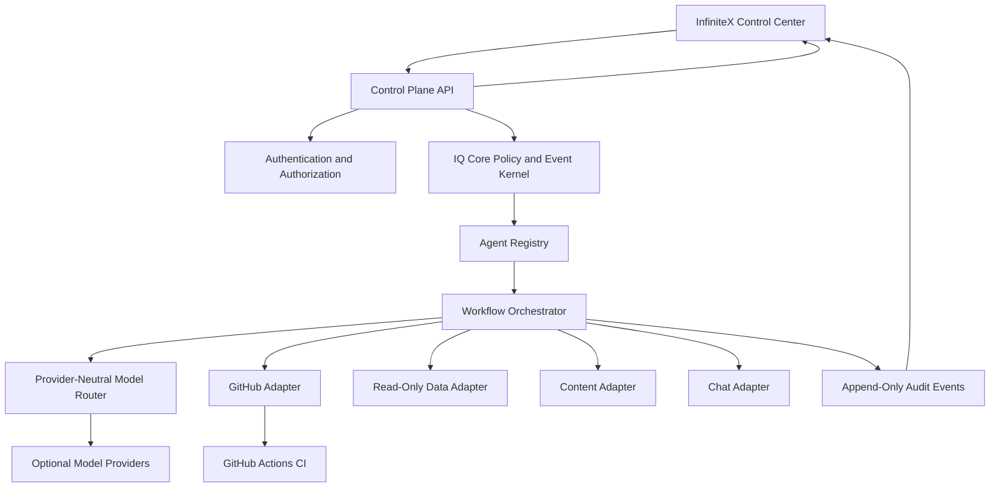
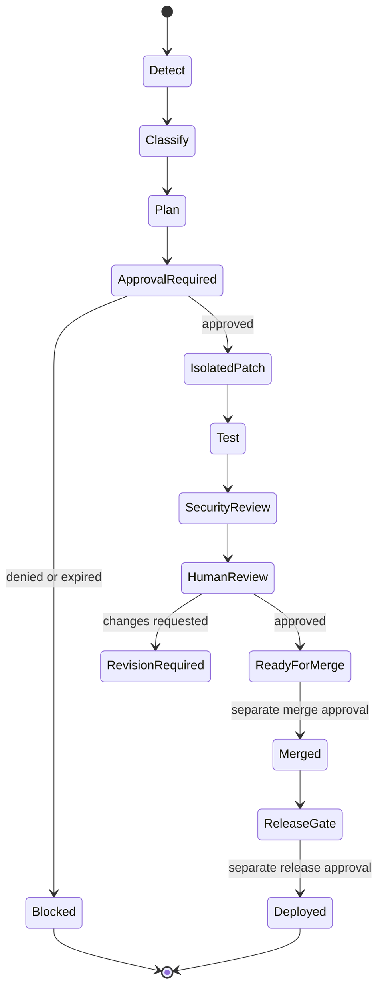

# InfiniteX AI Integration Architecture

**Status:** Proposed target architecture; not implemented by this documentation/CI foundation.  
**Design goals:** modular, provider-neutral, Android-friendly UI, zero-cost-first development, least privilege, observable behavior, and human-controlled changes.

## 1. Architecture principles

1. **One control plane, many bounded agents.** Agents are adapters behind a common contract, not unrelated front-end buttons.
2. **Server-side authority.** Provider keys, GitHub credentials, database service keys, and privileged operations never run in the browser.
3. **Default deny.** Every agent has an explicit capability manifest. Missing capability means denied.
4. **Human approval for consequential actions.** No autonomous merge, deploy, migration, billing change, secret creation, or destructive operation.
5. **Provider neutrality.** Model choice is configuration. No model name implies entitlement, availability, quality, or zero cost.
6. **Deterministic fallback.** UI, policy, validation, and tests should work without a model provider.
7. **Evidence before status.** “Connected”, “secure”, “tested”, and “healthy” require current, recorded evidence.
8. **Small blast radius.** Agents receive only the repository, files, tools, and time budget required for one task.

## 2. Logical system



This is a target diagram. It does not claim these services currently exist.

## 3. Component responsibilities

### A. InfiniteX Control Center (React)

Responsibilities:
- Mobile-first command center and responsive navigation.
- Show agent registry, repository inventory, workflow runs, audit events, cost budgets, and approval queue.
- Display explicit states: `DEMO`, `OFFLINE`, `CONNECTED`, `DEGRADED`, `BLOCKED`, `NOT TESTED`.
- Never fabricate metrics. Static values must carry a visible DEMO label.
- Send user intent to the API; never call model providers or privileged GitHub APIs directly.

Suggested areas:
- Command Center
- AI Agents
- Model Router
- Workflows & CI
- Repositories
- Security Center
- Cost & Usage
- Audit & Approvals

### B. Control Plane API

Responsibilities:
- Authenticate the caller and authorize each operation.
- Validate request schemas, payload size, rate limits, and idempotency keys.
- Apply policy before invoking an agent or integration.
- Keep credentials server-side.
- Return operation IDs and explicit state transitions.
- Record audit events for both accepted and denied requests.

The API is a proposed server boundary. A deployment target must be selected only after a free-tier and data-location review.

### C. IQ Core policy and event kernel

Candidate reuse: `msdshopfinds12-spec-infiniteGX.7-IQ-Core`.

Responsibilities:
- Capability registry and policy decisions.
- Typed events and correlation IDs.
- Workflow state machine.
- Feedback/evaluation records.
- Deny-by-default action authorization.

Do not assume persistent memory or production sandboxing is complete. Review and test those features before relying on them.

### D. Agent Registry and adapters

Initial logical agents:

| Agent | Allowed initial capabilities | Explicitly excluded by default |
|---|---|---|
| Foreman / Orchestrator | Decompose tasks, assign bounded subtasks, collect results | Direct production writes |
| Repository Analyst | Read approved repository files, summarize evidence | Commit, merge, delete |
| CI Investigator | Read workflow runs, jobs, steps, logs where permitted | Rerun jobs unless separately approved |
| Code Repair Proposer | Generate patch proposal in isolated workspace/branch | Push to main, auto-merge, deploy |
| Chat Agent | Answer from approved context | Unbounded memory or secret access |
| Data Agent | Read-only queries against allowlisted data | DDL, DML, export of sensitive data |
| Content Agent | Draft and preview content | Publish/send without approval |
| Marketing Agent | Prepare campaigns and analytics summaries | Send, purchase, or publish automatically |
| Personal Agent | User-authorized, narrowly scoped tasks | Cross-account access without consent |

### E. Provider-neutral Model Router

The router should:
- Accept a task class, data classification, maximum token budget, and provider allowlist.
- Select at most one provider/model for a normal task; fan-out requires a documented evaluation reason and explicit budget.
- Enforce request timeout, output size, rate limits, and spend ceiling.
- Redact secrets and minimize context before transmission.
- Record provider, model identifier, latency, token usage, estimated cost, and result status when available.
- Support deterministic/offline mode without external calls.

**Free-first rule:** local deterministic tools and existing free allowances may be used where available, but free quotas can change and are not guaranteed. Do not promise unlimited free AI. Provider credentials and paid usage remain disabled until the user explicitly configures and approves them.

### F. GitHub Adapter

Start read-only:
- Read repository metadata, branches, files, workflow runs, jobs, and logs.
- Build an evidence-backed repository inventory.
- Propose changes as a patch set.
- Write only to an approved isolated branch after an explicit approval record.
- Require a separate approval for PR creation, merge, release, or deployment.

The GitHub App/token must use least privilege. Never pass credentials to a model or browser client.

### G. Audit and approval service

Every operation should have:
- `operation_id`, `correlation_id`, actor, requested capability, target, and timestamp.
- Policy decision and reason.
- Input/output hashes or safe summaries (not raw secrets).
- Agent/model identity and version when applicable.
- Approval identity, scope, expiry, and decision.
- Result status and evidence references.

## 4. Common agent contract

A minimal TypeScript interface for future implementation:

```ts
export type Capability =
  | "repo.read"
  | "repo.propose_patch"
  | "repo.write_branch"
  | "ci.read"
  | "ci.rerun"
  | "data.read"
  | "content.draft";

export interface AgentManifest {
  id: string;
  version: string;
  description: string;
  capabilities: Capability[];
  requiresModel: boolean;
  maxExecutionSeconds: number;
  dataClassification: "public" | "internal" | "confidential";
}

export interface AgentRequest {
  operationId: string;
  task: string;
  target?: { repository?: string; branch?: string; resourceId?: string };
  approvedCapabilities: Capability[];
  budget: { maxTokens: number; maxCostUsd: number };
  dryRun: true | false;
}

export interface AgentResult {
  operationId: string;
  status: "completed" | "proposed" | "blocked" | "failed";
  summary: string;
  evidence: Array<{ kind: string; reference: string }>;
  proposedChanges?: Array<{ path: string; patch: string }>;
}
```

The API must independently validate every field. An agent-supplied `approvedCapabilities` value is not authorization; authorization comes from the server-side policy engine.

## 5. Supervised self-repair lifecycle



A model may propose a patch, but it cannot approve its own patch. Tests and security review must run in an isolated environment. Failure returns the task to diagnosis; it must not trigger an unlimited repair loop.

## 6. API shape (proposed)

| Method | Route | Purpose | Default access |
|---|---|---|---|
| GET | `/api/v1/health` | Service health and build metadata | Authenticated/read-only |
| GET | `/api/v1/agents` | Agent manifests and capability status | Authenticated/read-only |
| POST | `/api/v1/operations` | Create a bounded task | Authenticated; policy checked |
| GET | `/api/v1/operations/{id}` | Read operation status | Owner/operator |
| GET | `/api/v1/repositories` | Read approved repo inventory | Authenticated/read-only |
| GET | `/api/v1/ci/runs` | Read CI evidence | Authenticated/read-only |
| GET | `/api/v1/approvals` | Read pending approvals | Authorized approver |
| POST | `/api/v1/approvals/{id}/decision` | Approve/deny exact scope | Authorized human only |

No write endpoint should exist without authentication, authorization, schema validation, audit logging, rate limits, and tests.

## 7. Data and event model

Suggested core records:
- `AgentManifest`: agent identity, version, capabilities, execution limits.
- `Operation`: task, target, state, requester, timestamps.
- `Approval`: exact action, target, branch, file allowlist, expiry, approver, decision.
- `AuditEvent`: actor, operation, decision, evidence, correlation ID.
- `ProviderUsage`: provider, model, usage, cost estimate, budget outcome.
- `WorkflowEvidence`: repository, commit SHA, run/job IDs, conclusion, log references.

Use append-only audit semantics. Corrections should create new events rather than rewriting historical decisions.

## 8. Deployment and cost posture

- Build and test locally/CI before selecting a host.
- Prefer static hosting for the front-end and a separate, minimal server-side API.
- Keep a deterministic mode usable with no provider key.
- Use a database only after schema, access-control, backup, retention, and free-tier constraints are reviewed.
- Never assume a free tier is permanent or sufficient for production.
- No external integration should be activated merely because a template contains its SDK.

## 9. Implementation sequence

1. **Foundation:** inventory, approval policy, CI, status vocabulary.
2. **UI truthfulness:** mark static content DEMO; add responsive InfiniteX navigation and accessibility.
3. **Control plane:** health endpoint, auth boundary, schema validation, audit events.
4. **IQ Core adapter:** capability checks and event contracts.
5. **Read-only GitHub adapter:** repository and CI evidence.
6. **Agent registry:** register only reviewed, executable agents.
7. **Model router:** optional provider, deterministic fallback, explicit budget.
8. **Supervised repair:** isolated patch, test, security review, human approval.
9. **Release:** human-approved deployment with rollback plan.

Each phase has its own plan, test evidence, security review, and approval gate.
