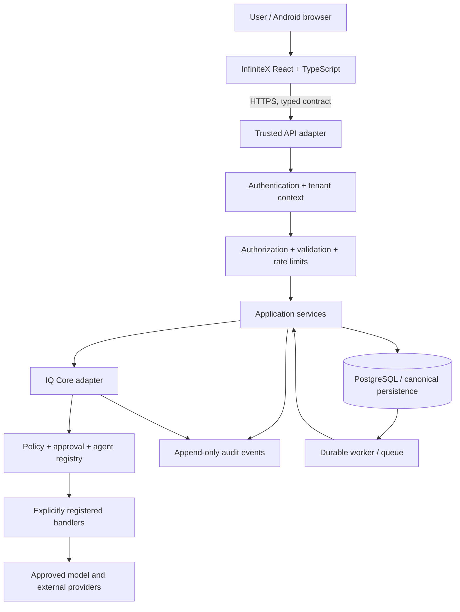

# InfiniteX Canonical Integration and Recovery Plan

**Status:** Proposed engineering authority; documentation-only baseline  
**Date:** 2026-11-20  
**Target repository:** `msdshopfinds12-spec/infiniteX-5626f61e`  
**Related architecture RFC:** `docs/architecture/INFINITEX-IQ-CORE-INTEGRATION-RFC.md`  
**Execution policy:** PLAN → APPROVE → BUILD → TEST → AUDIT → RELEASE

## 1. Executive decision

Build InfiniteX as a mobile-first React/TypeScript product backed by one trusted API boundary, one canonical persistence authority, and selectively reused IQ Core governance/orchestration components.

Do not merge whole repositories, copy every agent, or treat open pull requests as production-ready. Reuse source only after provenance, license, dependency, test, security, and runtime compatibility review.

This plan does not authorize merging pull requests, applying database migrations, changing secrets or billing, or deploying to production.

## 2. Evidence and confidence ledger

| Area | Current evidence | Status | Required next proof |
|---|---|---|---|
| InfiniteX main | React + TypeScript + Vite; main SHA previously inspected as `4538bd0cceb3d2ee6adbaf36777047108229cf3c` | VERIFIED snapshot | Refresh before implementation |
| IQ Core repository | `msdshopfinds12-spec/msdshopfinds12-spec-infiniteGX.7-IQ-Core` exists; relevant draft PRs #155, #156, #163, #164, #342, #404 were inspected | VERIFIED repository/PR metadata | Pin exact commit SHAs and inspect complete diffs/tests |
| IQ Core runtime | In-memory synchronous engine, explicit handler injection, governance components visible in candidate sources | PARTIAL | Runtime tests, concurrency, persistence, failure semantics |
| InfiniteX backend | Candidate Supabase Edge Function code exists in branches/PRs; main has no tracked `supabase/` directory in inspected snapshot | PARTIAL | Reconcile deployed source, Git source, config, schema and migrations |
| Migration history | Historical migration ledger references were discussed, but original SQL chain has not been recovered and proven complete | BLOCKED | Recover every migration body and verify checksums/order against a read-only DB inventory |
| Transactional step fencing | PR #35 introduces a PostgreSQL RPC migration and tests; exact-head GitHub Actions workflow run #44643645521 succeeded for listed Node/Deno/type-check/build steps | PARTIAL | Execute SQL catalog test and deterministic concurrency test on disposable local Supabase |
| Vercel | Prior checks reported `build-rate-limit` | BLOCKED for those checks | Inspect current deployment/build logs; do not infer source failure |
| Production parity | No complete source-to-deployed parity evidence | NOT VERIFIED | Read-only inventory of deployed functions, schema, config and runtime versions |

Evidence is time-bound. Re-fetch branch heads, PR metadata, workflow runs and deployment state immediately before any implementation decision. PR descriptions are claims until corroborated by exact-head artifacts.

## 3. Cross-repository source inventory

### 3.1 InfiniteX

Canonical product repository: `msdshopfinds12-spec/infiniteX-5626f61e`.

Responsibilities:
- Mobile-first user experience and accessibility.
- Typed frontend domain models and API client.
- Trusted backend integration contract.
- Product settings, workspace and workflow presentation.
- User-visible execution status, audit history and error recovery.

### 3.2 IQ Core

Reference repository: `msdshopfinds12-spec/msdshopfinds12-spec-infiniteGX.7-IQ-Core`.

Potential reusable responsibilities:
- Task lifecycle and orchestration kernel.
- Explicitly registered agent handlers.
- Policy and permission evaluation.
- Approval gates and governed workflow service.
- Event dispatch and isolated subscriber failures.

Candidate PRs are not automatically approved dependencies:
- #155: governed workflow engine.
- #156: backend/frontend integration.
- #163: runtime hardening.
- #164: reference alignment and acceptance tests.
- #342: Python test discovery repair.
- #404: CI runner evidence recovery.

Before reuse, record for each selected component: source repository, immutable commit SHA, source path, license, transitive dependencies, API contract, tests, security review, and local modifications.

### 3.3 Other reference repositories

- `ai-master-controller`: agent/controller patterns.
- `personal-agent`: authentication, persistence and connector isolation patterns; different stack, so reuse concepts selectively.
- `eve-software-factory-template`: independent planner/implementer/reviewer workflow.
- `INNERVERSE`: architecture and governance reference.
- `bagsikai-agent`: additional agent implementation reference.
- `infiniteX-get-language`: language-design reference, not a runtime dependency by default.

No repository is considered a dependency until its code is pinned, reviewed and tested.

## 4. Target architecture



The diagram is a target, not proof that all components currently exist.

### 4.1 Trust boundaries

1. Browser input is untrusted.
2. Browser must never choose privileged tenant IDs, service roles, arbitrary agent names, tool permissions, or unrestricted provider endpoints.
3. API derives authenticated subject and tenant from verified credentials and server-side membership.
4. Every object read/write is scoped to the authorized tenant and owner.
5. Privileged secrets remain server-side; never expose service-role keys to browser bundles.
6. IQ Core receives a narrow, validated execution envelope from the trusted adapter.
7. External tools/models require explicit registry, permission, budget, timeout and audit policy.

### 4.2 Canonical ownership

- InfiniteX owns product UI and user interaction.
- Trusted backend owns authentication enforcement, authorization, validation, tenant resolution, persistence and audit.
- PostgreSQL owns durable state and transactional invariants.
- IQ Core owns governed orchestration decisions and dispatch through explicitly registered handlers.
- Queue/worker owns durable asynchronous execution and retry scheduling.
- Provider adapters own vendor-specific model/API protocols.

Avoid two sources of truth for workflow status, user identity, agent registry, or approval state.

## 5. Backend decision gate

Do not select a final deployment topology until the following are proven:

1. Which Supabase project is authoritative for this product.
2. Whether deployed Edge Functions match a reviewed Git commit.
3. Which migration ledger entries are applied.
4. Whether original migration SQL is available for every applied version.
5. Whether the IQ Core Python service can be hosted within the free-tier and operational constraints.
6. Whether the trusted API adapter can call IQ Core over authenticated service-to-service transport.
7. Whether a single durable workflow store and queue can meet retry, timeout, and concurrency requirements.

Preferred low-cost option, subject to proof: Supabase PostgreSQL + Edge Functions as the trusted API boundary, with IQ Core behind a private authenticated adapter only if its runtime and hosting constraints are satisfied.

Alternative A: implement a TypeScript orchestration adapter in the existing backend and port only the required, reviewed IQ Core governance semantics. This reduces cross-runtime operations but must not silently discard IQ Core behavior.

Alternative B: host IQ Core separately behind a private API. Use only if deployment, networking, monitoring, secrets, and ongoing free-tier limits are verified.

Do not operate both options in production simultaneously as competing sources of truth.

## 6. Database provenance and schema recovery

### 6.1 Required artifacts

Recover and archive:
- All migration SQL files, including exact filenames/version prefixes.
- Migration ledger rows from the authoritative database.
- Git commit and branch provenance for each file.
- Checksums of file contents.
- Supabase CLI/config versions and relevant project settings.
- Schema-only database dump or catalog snapshot from a read-only connection.
- Existing Edge Function source and deployed function metadata.

A ledger row is not a substitute for its SQL body. Never fabricate a missing historical migration from current schema state.

### 6.2 Required workflow schema contract

PR #35 references the following contract. These are required fields to verify, not claims that production currently has them.

- `workflow_runs`: `id`, `workflow_id`, `owner_id`, `status`, `attempt`.
- `workflows`: `id`, `owner_id`.
- `workflow_steps`: `id`, `workflow_id`.
- `workflow_step_runs`: `id`, `run_id`, `step_id`, `owner_id`, `status`, `input`, `output`, `error_message`, `attempt`, `started_at`, `finished_at`.
- Unique constraint or unique index on `workflow_step_runs(run_id, step_id)`.

Also verify foreign keys, data types, nullability, defaults, indexes, RLS policies, grants, function owner, function execute privileges, and service-role table permissions.

### 6.3 PR #35 SQL review checklist

Review `simula_transition_workflow_step` for:
- Correct `SECURITY DEFINER` owner and empty `search_path`.
- Fully qualified relation and function references.
- Exact owner/run/workflow/step relationship checks.
- Parent row locking and attempt fencing.
- Atomic terminal state transitions.
- Correct conflict target and attempt predicate.
- Rejection of stale, duplicate, unauthorized and out-of-order transitions.
- Explicit grants only to the intended server role.
- No bypass through direct REST table writes.
- RPC schema-cache refresh and deployment sequencing.

Do not apply this migration until its prerequisites are proven against the canonical schema.

## 7. Workflow execution invariants

The durable workflow engine must enforce:

1. A run belongs to one authorized tenant/owner and workflow.
2. A run attempt is monotonically increasing.
3. A worker may mutate a step only for the current run attempt.
4. Each step has one canonical row per run.
5. Start/success/failure transitions are atomic.
6. Duplicate requests are idempotent.
7. Retry policy is bounded and explicit.
8. A stale worker cannot overwrite a newer attempt.
9. Terminal runs cannot silently return to active state.
10. Every transition is auditable.
11. Cancellation and timeout are explicit states.
12. Unknown or unregistered handlers fail closed.

Recommended run state machine:

```text
queued -> running -> succeeded
                  -> failed
                  -> timed_out
                  -> cancelled

failed -> queued (new attempt only, authorized retry)
timed_out -> queued (new attempt only, authorized retry)
```

Transitions must be implemented in one transactional authority, not inferred from UI state.

## 8. API contract baseline

Use versioned JSON endpoints with runtime validation.

Suggested resources:
- `GET /api/v1/me`
- `GET /api/v1/workflows`
- `POST /api/v1/workflows/{workflowId}/runs`
- `GET /api/v1/runs/{runId}`
- `POST /api/v1/runs/{runId}/cancel`
- `GET /api/v1/runs/{runId}/events`

Required controls:
- Authentication and server-derived tenant context.
- Zod or equivalent runtime schema validation.
- Idempotency key for run creation.
- Request correlation ID.
- Bounded payload sizes and pagination.
- Rate limits and execution budgets.
- Structured errors with stable error codes.
- No secret, prompt-internal, or provider credential leakage.
- Explicit API versioning and backward compatibility tests.

These endpoints are a proposed contract, not existing deployed endpoints.

## 9. Security baseline

- Threat model tenant boundary, confused deputy, privilege escalation, SSRF, prompt injection, unsafe tool invocation, replay, resource exhaustion and data leakage.
- Verify Supabase RLS for every tenant-owned table.
- Keep privileged credentials exclusively server-side.
- Allowlist provider hosts and tool identifiers.
- Enforce per-user/tenant rate, token, concurrency and spend budgets.
- Validate all model output before it can trigger a tool or state transition.
- Require human approval for sensitive or irreversible actions.
- Redact credentials and personal data from logs.
- Use least-privilege service roles and narrowly scoped functions.
- Add dependency and secret scanning to CI.
- Maintain an incident and rollback procedure.

AI output is untrusted input. Never grant an agent authority merely because its model response requests it.

## 10. Frontend product and design specification

Design direction: polished, calm, modern engineering workspace, Android-first.

Primary navigation:
- Overview
- Workflows
- Agents
- Runs and activity
- Integrations
- Security and approvals
- Settings

Core UI requirements:
- Responsive navigation and touch targets.
- Accessible semantic HTML, keyboard navigation and visible focus.
- Light/dark themes with contrast verification.
- Clear loading, empty, offline, error and retry states.
- Real run states sourced from backend; never fabricate success.
- Run timeline with timestamps, attempt number and trace ID.
- Approval screen that clearly explains requested action and scope.
- Agent cards display only capabilities proven by registry metadata.
- Mobile layouts tested at narrow Android viewport widths.
- No decorative dashboard metric that implies live backend data without a real source.

## 11. Testing strategy and release evidence

### Unit tests
- API validation and error mapping.
- Permission and tenant policy.
- IQ Core adapter and handler registry.
- State machine and idempotency.
- Retry and timeout calculation.

### Integration tests
- Authenticated API to database.
- RLS and cross-tenant denial.
- IQ Core adapter request/response.
- Queue enqueue/claim/ack/retry.
- Audit event persistence.

### Concurrency and resilience
- Two workers claim the same run.
- Old attempt completes after a new attempt begins.
- Duplicate idempotency key.
- Duplicate webhook/event delivery.
- Database connection interruption.
- Worker crash before and after state persistence.
- Retry exhaustion and dead-letter behavior.
- Cancellation racing with completion.

### Required environments
- Disposable local Supabase/PostgreSQL for mutating tests.
- Synthetic test users and tenant fixtures.
- No production fixture mutation.
- Deterministic clocks and controlled interleavings where practical.

### CI acceptance
- Install from lockfile.
- Lint and format checks.
- TypeScript strict type-check.
- Unit tests.
- Python tests for selected IQ Core components.
- Deno tests for Edge Functions.
- SQL catalog tests.
- Local database migration replay from an empty database.
- Production build.
- Dependency/security scans.
- Exact-head run evidence attached to the reviewed commit.

A skipped test is not a pass. A type-check is not a runtime integration test.

## 12. Ordered execution roadmap

### Phase 0 — Evidence recovery
- Refresh branch/PR/commit snapshots.
- Recover migration files and deployed schema metadata.
- Pin IQ Core source commits.
- Identify duplicate/stacked branches and dependency lineage.
- Produce source-to-runtime parity matrix.

Exit: canonical provenance package reviewed.

### Phase 1 — Architecture and contract freeze
- Approve backend topology.
- Approve identity and tenant model.
- Approve API and workflow contracts.
- Approve data ownership and failure semantics.

Exit: architecture decision record and contract tests.

### Phase 2 — Frontend foundation
- Select one consolidated frontend candidate.
- Reconcile branding/package metadata.
- Remove generated build artifacts from source control only through a reviewed change.
- Complete Android responsive and accessibility review.

Exit: exact-head CI and manual UI evidence.

### Phase 3 — Backend recovery
- Reconcile Edge Function source.
- Recover migration chain.
- Verify RLS, grants and schema.
- Replay migrations on disposable local DB.

Exit: schema provenance and backend tests.

### Phase 4 — Workflow reliability
- Review PR #34/#35 lineage and code.
- Prove transactional fencing.
- Run deterministic two-worker integration tests.
- Verify idempotency, retries, cancellation and timeouts.

Exit: concurrency and failure-recovery evidence.

### Phase 5 — IQ Core adapter
- Pin selected IQ Core components.
- Implement narrow typed adapter.
- Enforce registered handlers and permission policy.
- Add contract and failure-isolation tests.

Exit: end-to-end test in non-production environment.

### Phase 6 — Product completion
- Connect real authenticated data.
- Implement workflows, run timeline, approvals and integrations.
- Remove or label demo-only features.
- Verify responsive and accessibility behavior.

Exit: feature acceptance checklist complete.

### Phase 7 — Production readiness audit
- Security and privacy review.
- Load/concurrency and recovery tests.
- Backup/restore and rollback rehearsal.
- Monitoring, alerts and runbooks.
- Cost and free-tier limit review.
- Exact deployed commit and migration ledger verification.

Exit: signed release checklist.

### Phase 8 — Human-approved release
- Present release candidate, risks, costs and rollback.
- Obtain explicit production release approval.
- Deploy only the approved commit.
- Verify health and smoke tests.
- Stop/rollback if acceptance criteria fail.

No automatic production release.

## 13. Alternative implementation paths

| Path | Benefits | Trade-offs | Selection rule |
|---|---|---|---|
| Supabase + Edge Functions + IQ Core adapter | Reuses existing backend candidate and Python IQ Core | Cross-runtime operations and hosting | Preferred only if provenance/runtime parity is proven |
| TypeScript backend + selected IQ Core semantics | Simpler deployment and one runtime for app services | Requires carefully reviewed port/adaptation | Choose if Python hosting is not viable |
| Separate private IQ Core service | Preserves Python engine | More operations, auth, monitoring and network dependencies | Choose only with sustainable hosting |
| Frontend demo mode | Safe UI progress without backend claims | Not a production product | Clearly label as demo; never represent as live |

Do not select based on sophistication alone. Select the simplest option that meets security, durability, testability, budget and maintainability requirements.

## 14. Change-control rules

The following require separate explicit approval:
- Merge any pull request.
- Apply or repair a production migration.
- Change production secrets, keys or permissions.
- Change billing or upgrade a paid plan.
- Deploy or publish production.
- Delete branches, files, data or resources.
- Run destructive or fixture-mutating tests against any non-disposable environment.

Creating this plan or a draft PR does not grant any of those permissions.

## 15. Definition of done

InfiniteX is production-ready only when:
- The canonical source and deployed runtime are traceable to immutable commits.
- The complete migration history is proven and replayable.
- Tenant isolation and least privilege are tested.
- Workflow state transitions are transactional and concurrency-safe.
- IQ Core integration uses pinned, reviewed components and explicit handlers.
- All critical tests pass on the exact release candidate.
- Android accessibility and responsive behavior are manually verified.
- Monitoring, backup, restore and rollback are demonstrated.
- Costs and service limits are documented.
- Human release approval is recorded.

**Current release status: NOT READY / NOT AUTHORIZED.**

This document is a recovery and implementation plan. It does not claim that production code, database integration, AI providers, or deployments are complete.


## 16. Migration provenance and transactional fencing audit — 2026-11-20

### 16.1 Repository-wide branch scan result

A read-only scan of the 90 branches visible at the time of inspection found:
- Historical branches `phase-4/database-persistence`, `phase-3/backend-api`, `feat/phase-3d4-trusted-backend`, and `gh-20/secure-backend-foundation` do not contain tracked `.sql` files or a `supabase/` tree at their inspected heads.
- Workflow reliability branches contain Edge Function sources but no historical schema migration chain.
- The PR #35 candidate lineage contains one migration: `20261120000000_phase_4n8b_transactional_step_fencing.sql`.
- The later verification branch `eng/phase-4n27-transactional-fencing-verification` adds a synthetic schema fixture and an isolated PostgreSQL runner, not historical production migrations.

This scan is limited to visible repository branches and tracked trees. It does not prove that SQL never existed in unlisted repositories, deleted refs, external backups, or the live database.

### 16.2 New verification evidence

Exact commit inspected: `0d8e74fbef0742cea85588a1f183fbb17433a5e4`.

GitHub Actions run #44635578904 completed successfully:
- Disposable PostgreSQL 16 service container initialized.
- Synthetic contract fixture applied.
- Candidate transactional fencing migration applied.
- SQL privilege/catalog assertions passed.
- Two independent PostgreSQL sessions exercised the parent-row lock and competing same-generation start.
- Duplicate/stale generation rejection passed.
- Transaction rollback behavior passed.
- Newer-generation replacement and completion passed.
- Node/Deno security tests and application build/type-check steps in the same job passed.

Run: https://github.com/msdshopfinds12-spec/infiniteX-5626f61e/actions/runs/44635578904

**Evidence classification: VERIFIED for the synthetic contract and isolated PostgreSQL test harness only. NOT VERIFIED for production schema compatibility.** The fixture explicitly states that it models only the columns and unique key consumed by the RPC and is not evidence of production schema shape.

### 16.3 Important test-design improvement

The independent-session test is stronger than the earlier `Promise.all`-only integration test because it deliberately holds the parent `workflow_runs` row lock in Session A while Session B connects and attempts the RPC. This creates a controlled lock interleaving and proves the expected stale/duplicate rejection against PostgreSQL 16 in the disposable CI service.

Keep both tests for distinct purposes:
- Synthetic SQL contract test: function signature, role execute grants and core database invariants.
- Disposable PostgreSQL runner: real PostgreSQL transaction, lock, rollback and stale-generation behavior.
- Local Supabase integration test: PostgREST/RPC wiring and Supabase-specific role/config behavior, only against loopback disposable Supabase.

### 16.4 Remaining blockers and audit questions

1. Historical production migration SQL remains unrecovered. Do not reconstruct it from this synthetic fixture.
2. Production schema parity remains unknown: constraints, foreign keys, RLS, table grants, policies, triggers, function ownership and existing data were not represented in full by the fixture.
3. The SQL runner drops and recreates four `public.workflow_*` tables. Its exact URL guard is a useful safety control, but it must remain limited to its ephemeral CI service. Never point it at a shared or production database.
4. The RPC accepts `p_owner_id` as a parameter and checks it against the parent run. The authenticated server boundary must derive this value from verified identity and must not trust a browser-supplied owner ID.
5. Review worker code to ensure all step mutations go through the RPC and there are no alternate direct REST/table writes that bypass fencing.
6. Review queue claim and stale-recovery functions to confirm they lock the same parent run row and update attempt/status atomically.
7. Confirm the database function owner and all underlying table privileges under the actual Supabase deployment role model.
8. Verify terminal state transitions, retry attempt increments, cancellation, timeout, and worker lease expiry as a complete state machine.
9. The verification branch has Vercel build-rate-limit failures; the successful GitHub Actions run is separate evidence and does not establish a deployment.

### 16.5 Updated recovery conclusion

The transactional fencing implementation now has meaningful isolated PostgreSQL 16 test evidence. This advances it from unexecuted candidate to **PARTIAL — isolated database contract verified**.

The correct next step is not to invent or apply a historical migration chain. It is to obtain a read-only schema/migration inventory from the authoritative Supabase project and reconcile it with available backups, archived branches, CI artifacts and repository history. Only after provenance is proven should a separate forward-only migration plan be prepared.

Production release remains NOT READY and NOT AUTHORIZED.
