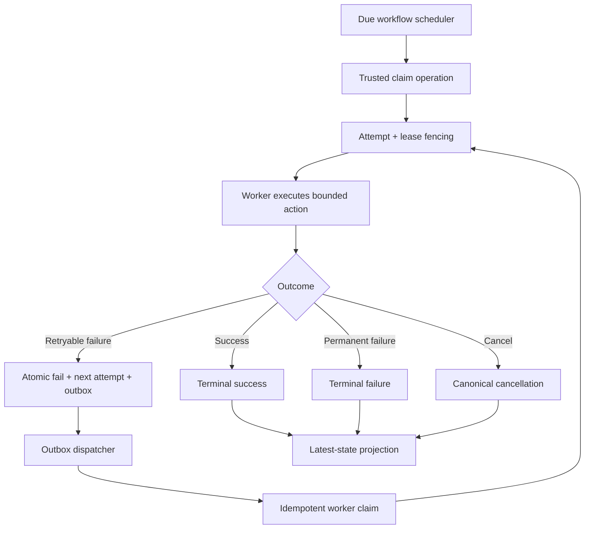

# Phase 61 — Live Schema Contract V2 Reconciliation

**Status:** Evidence-backed design record; implementation blocked pending independent schema review  
**Target:** InfiniteX / Simula durable workflow engine  
**Inspection mode:** Read-only live Supabase catalog and deployed Edge Function inspection  
**Database:** Ashaa-INX (`vepacoemkhudamfaccah`), PostgreSQL 17, `ap-northeast-2`  
**Repository base inspected:** `feat/phase-51-durable-workflow-engine`  
**Related implementation:** PR #91 — Phase 60 transactional retry orchestration

> This document records the read-only findings supplied by the Phase 61.0 inspection. It is not a migration, a declaration that production is ready, or authorization to change the hosted database.

## 1. Executive decision

Do not apply a workflow migration or deploy a worker from this branch yet.

The live database has an existing workflow model and active worker/cron infrastructure. The Phase 60 application-layer retry contract introduces immutable attempts and transactional outbox semantics. The existing `workflow_step_runs` uniqueness constraint (`UNIQUE (run_id, step_id)`) indicates that this table is a current-state row per step/run, not a suitable append-only attempt ledger.

**Recommended compatibility architecture:**

1. Keep `workflow_step_runs` as the latest-state projection during migration.
2. Add a separate immutable attempt ledger only after the complete live catalog and migration provenance are reviewed.
3. Add an outbox in the same transaction that terminalizes one attempt and creates the next attempt.
4. Route all lifecycle writes through trusted server-side operations.
5. Keep user-facing status reads owner-scoped and prevent browser clients from writing attempt lifecycle state.
6. Reconcile tracked worker source with deployed Edge Function source before any worker rollout.

## 2. Verified inspection findings

### 2.1 Project and database

- Supabase project: `Ashaa-INX`
- Project ref: `vepacoemkhudamfaccah`
- PostgreSQL: 17
- Region: `ap-northeast-2`
- Project status at inspection: `ACTIVE_HEALTHY`
- Live migration history: 19 entries

### 2.2 Public application tables

The inspection returned 14 public application tables, all reporting RLS enabled:

- `profiles`
- `tools`
- `user_projects`
- `workflows`
- `workflow_steps`
- `workflow_runs`
- `workflow_step_runs`
- `workflow_logs`
- `usage_logs`
- `subscriptions`
- `payments`
- `platform_api_keys`
- `billing_webhook_events`
- `credit_ledger`

The live workflow model therefore already exists. Do not create replacement tables based on assumptions or a stale branch snapshot.

### 2.3 Current-state uniqueness

The inspected constraint on `workflow_step_runs` is:

```sql
UNIQUE (run_id, step_id)
```

This is a one-row-per-step-per-run shape. It conflicts with using this same relation as the append-only history for multiple attempts of one step.

**Decision:** do not drop or weaken this constraint as a shortcut. Preserve the current projection and introduce a separately keyed history model only after the complete schema contract is approved.

### 2.4 RLS and grants

- All 14 inspected public application tables report RLS enabled.
- The inspected workflow policies include owner-scoped access.
- The inspected user-facing claim path includes an ownership check.
- The internal cron worker uses the service-role client.
- `billing_webhook_events` has RLS enabled and no client table grants for `anon` or `authenticated`; the service role has access.
- The Security Advisor reports the webhook table as RLS-enabled with no policies. Given the absence of client grants, do not add a broad client policy merely to silence this notice.

RLS enabled does not by itself prove policy correctness. A separate negative authorization test matrix is still required.

### 2.5 Cron scheduling

Two active cron jobs were returned:

| Job | Schedule | State |
|---|---|---|
| `simula-enqueue-due-workflows` | Every minute | Active |
| `simula-workflow-cron-worker-every-minute` | Every minute | Active |

The worker cron metadata references Vault and the custom worker-secret header. Secret values were not selected or retrieved.

### 2.6 Performance advisor

The Performance Advisor returned six informational unused-index findings across:

- `user_projects`
- `usage_logs`
- `payments`
- `platform_api_keys`
- `billing_webhook_events`
- `credit_ledger`

Do not drop these indexes based only on current low/empty table statistics. Require query workload evidence, explain plans, and a rollback plan before any index removal.

### 2.7 Migration provenance

The live migration history reports 19 entries. The inspected `main` tree did not expose a `supabase/migrations/` directory.

This is a migration reproducibility risk, not proof that no migration files exist on any branch or in any external archive. Before schema changes, reconcile:
- live migration history,
- all relevant Git branches and tags,
- any archived migration source,
- the exact live catalog,
- the schema snapshot/contract used by existing CI gates.

Do not fabricate historical migrations from the current live schema and label them as original provenance.

## 3. Deployed-versus-tracked worker drift

The deployed Edge Functions inspected were:

- `simula-workflow-worker`
- `simula-workflow-cron-worker`

The deployed implementations contain an in-memory retry loop and update the existing step-run record. The deployed user worker authenticates the user and scopes claimed work to that owner. The cron worker validates its custom secret and uses the service-role client.

The tracked worker source inspected on `feat/phase-51-durable-workflow-engine` differs from the deployed versions. In particular, the deployed code contains retry-loop/upsert behavior that is not present in the tracked source snapshot.

Important limitations in the deployed implementation:

- retries happen inside one worker invocation and are not independently persisted as immutable attempts;
- the same current step-run record is reused;
- transient and permanent failure classification is not yet represented by the Phase 60 durable orchestration contract;
- `timeout_seconds` is read but the inspected execution path does not enforce a real execution timeout;
- the deployed worker is not yet wired to the Phase 60 retry orchestrator.

**Release blocker:** no worker source deployment until the exact deployed source is reconciled into Git, reviewed, and tested against the final schema contract.

## 4. Canonical attempt model

The Phase 60 contract and prior canonical attempt/lease work establish these domain distinctions. Keep them separate:

| Concept | Meaning | Must not be conflated with |
|---|---|---|
| Logical attempt number | Which retry attempt this is for one step | Run claim count |
| Run claim generation | A worker claim/fencing generation for the run | Logical retry count |
| Lease generation | Monotonic fencing token for ownership of a lease | Attempt number |
| Idempotency key | Stable identity for a logical scheduling operation | Delivery count |
| Outbox delivery count | Number of dispatch attempts for an event | Workflow attempt number |

Lifecycle contract:

- An attempt is created in `queued`.
- A trusted worker claims it and moves it to `running`.
- It reaches one terminal outcome.
- A retry creates a new attempt; a terminal attempt is never reopened.
- Cancellation uses its own canonical operation and must not be treated as a retryable ordinary failure.
- Stale workers are rejected using lease-generation compare-and-swap (CAS).
- Recovery creates a new lease generation; it does not revive a terminal attempt.
- External provider side effects are not executed inside database transactions.

## 5. Proposed logical schema — design only

Names below are proposals. They are not verified as existing live objects and must not be applied until the schema review is complete.

### 5.1 `workflow_step_attempts`

Purpose: immutable attempt history.

Proposed logical fields:

- `id` — primary key
- `workflow_run_id` — owning workflow run
- `step_id` — workflow step identity
- `attempt_number` — positive logical attempt number
- `status` — canonical lifecycle status
- `lease_generation` — monotonic fencing generation
- `idempotency_key` — scoped unique scheduling identity
- `started_at`, `finished_at` — lifecycle timestamps
- `error_code`, `error_summary` — sanitized failure metadata
- `created_at` — immutable creation timestamp

Required invariants to encode after schema reconciliation:

1. Unique logical attempt identity per run and step.
2. Unique scoped idempotency key.
3. Positive attempt number and nonnegative lease generation.
4. Legal lifecycle transitions only.
5. Terminal attempt rows are immutable except for explicitly approved metadata that does not alter lifecycle identity.
6. Foreign keys match the actual live ownership and cascade/restrict behavior.
7. No client role can directly insert/update/delete lifecycle rows.

### 5.2 `workflow_attempt_outbox`

Purpose: transactional, durable dispatch intent.

Proposed logical fields:

- `id`
- `event_type`
- `aggregate_id` (attempt identity)
- `idempotency_key`
- `payload_version`
- `payload` (minimal, non-secret dispatch metadata)
- `available_at`
- `delivery_count`
- `locked_at`, `locked_by`, `lease_generation`
- `delivered_at`, `last_error_code`
- `created_at`

Required invariants:

- Outbox event and next queued attempt are inserted in the same transaction.
- Unique event idempotency prevents duplicate scheduling.
- Dispatch is at-least-once; consumers must be idempotent.
- No provider secret or raw credential is stored in event payload.
- Acknowledgment is fenced to the current dispatcher lease.
- Poison events are observable and quarantined without silently disappearing.

### 5.3 Existing `workflow_step_runs`

Retain as a latest-state projection during transition. It must not become the source of immutable attempt history.

Projection updates must be monotonic and derived from the canonical attempt ledger. A delayed event from an older attempt must never overwrite a newer attempt's state.

## 6. Atomic retry transaction contract

The database adapter should expose one trusted operation equivalent to:

```ts
type RetryDecision =
  | { kind: "scheduled"; nextAttemptId: string; outboxEventId: string }
  | { kind: "terminal"; attemptId: string }
  | { kind: "already_scheduled"; nextAttemptId: string };

async function failAndScheduleRetryAtomically(
  input: RetryFailureInput
): Promise<RetryDecision>;
```

Transaction algorithm:

1. Lock the current attempt and relevant run/step projection rows in a documented lock order.
2. Verify tenant/user ownership and current worker identity.
3. Verify the expected lease generation; reject stale workers.
4. Verify the attempt is currently running and not terminal.
5. Persist the terminal failure outcome for the current attempt.
6. Evaluate retry policy using the persisted logical attempt number and bounded retry limit.
7. If retry is eligible, insert a new queued attempt with a deterministic scoped idempotency key.
8. Update the latest-state projection only if the new attempt is newer.
9. Insert the outbox event with a unique idempotency identity.
10. Commit all writes together; any failure rolls back all writes.

Never hold a database transaction open while calling an external provider, model API, webhook, or other network service.

## 7. Worker and dispatcher target design



Worker requirements:

- server-side trusted identity only;
- lease-generation fencing on every state-changing operation;
- bounded execution time enforced by an actual abort/timeout mechanism;
- retry classification with bounded backoff and jitter;
- no untrusted browser-supplied owner IDs;
- no provider secret in logs or outbox payload;
- structured, redacted logs with correlation IDs;
- idempotency or reconciliation for any external side effect;
- graceful shutdown and lease expiry recovery;
- metrics for queue age, attempt count, retry rate, timeout rate, stale-lease rejection, and outbox lag.

## 8. Safe rollout plan

### Gate A — schema evidence

- Capture full catalog definitions for workflow tables, all related foreign keys, unique/check constraints, indexes, triggers, policies, grants, sequences, function signatures/bodies, function ACLs, and cron definitions.
- Capture exact migration history and map each version to a reviewed source artifact.
- Export no secrets or application row data.
- Have a human reviewer compare the captured contract to the repository's migration chain.

### Gate B — disposable PostgreSQL

- Rebuild the schema in a disposable database from the reconciled migration chain.
- Run concurrency tests for two workers claiming the same attempt.
- Run stale-lease fencing tests.
- Run duplicate outbox delivery tests.
- Force failures at each transaction write and verify complete rollback.
- Verify owner isolation and RLS with anon/authenticated/service-role test identities.
- Verify cancellation cannot enter the retry path.
- Verify projection monotonicity under out-of-order events.

### Gate C — implementation

- Add migration files only after Gate A approval.
- Add adapter with transaction and CAS guarantees.
- Add adapter integration tests against PostgreSQL, not only in-memory fakes.
- Reconcile tracked worker source with deployed source.
- Integrate worker behind a disabled feature flag or non-production-only queue.
- Keep provider execution disabled until provider idempotency/reconciliation is demonstrated.

### Gate D — release readiness

- Exact-head CI passes.
- Independent code and database review passes.
- Security and performance regression tests pass.
- Rollback and recovery procedures are rehearsed.
- Human explicitly approves production migration and worker deployment.
- Deployment and post-deployment verification are separately approved.

## 9. Required test matrix

| Test | Expected result |
|---|---|
| Two workers claim same queued attempt | Exactly one current lease wins |
| Old lease completes after a new lease | CAS rejects stale update |
| Duplicate retry request | Same next attempt returned |
| Duplicate outbox delivery | Consumer executes idempotently |
| Outbox insert fails | Failure and next attempt both roll back |
| Projection update fails | Entire transaction rolls back |
| Retry limit reached | Current attempt terminal; no new attempt |
| Permanent failure | No retry attempt |
| Cancellation | Cancellation path only |
| Older attempt event arrives late | Newer projection remains unchanged |
| User A reads User B workflow | Denied |
| Browser tries lifecycle write | Denied |
| Worker timeout | Bounded execution and recoverable lease |
| Provider response is ambiguous | Reconciliation/idempotency prevents duplicate side effect |

## 10. Current gates and status

| Gate | Status | Evidence / blocker |
|---|---|---|
| Live project identification | Verified | Project ref and PostgreSQL version inspected |
| Public table/RLS inventory | Verified | 14 public tables returned |
| Current step-run uniqueness | Verified | `UNIQUE (run_id, step_id)` |
| Cron inventory | Verified | Two active jobs returned |
| Deployed worker behavior | Partial | Deployed source inspected; tracked source differs |
| Complete migration provenance | Blocked | 19 live entries; inspected main tree has no migration directory |
| Full schema/function/ACL review | Pending independent evidence review | Catalog findings must be reconciled and archived |
| PostgreSQL attempt adapter | Not implemented | Phase 60 adapter is an interface/in-memory fake |
| Cross-process concurrency | Not tested | Requires disposable PostgreSQL |
| Production integration | Blocked | No approved migration/deploy |

## 11. Explicit non-goals and safety boundary

This document-only change does not:

- execute SQL against Supabase;
- add, alter, or drop database objects;
- change RLS policies, grants, roles, cron jobs, Vault, or secrets;
- read application records or secret values;
- deploy or modify Edge Functions;
- enable workflow enqueueing or provider execution;
- merge PR #91 or this documentation PR;
- deploy to Vercel or change billing.

## 12. References

- Phase 60 retry orchestration: PR #91
- Canonical workflow attempt/lease contract: PR #87 / Phase 58 work
- Supabase project: `vepacoemkhudamfaccah`
- Tracked worker files:
  - `supabase/functions/simula-workflow-worker/index.ts`
  - `supabase/functions/simula-workflow-cron-worker/index.ts`

---

**Decision requested from reviewers:** approve the proposed compatibility architecture and schema invariants for disposable PostgreSQL implementation, or request changes. Approval of this document is not approval to migrate or deploy production.
