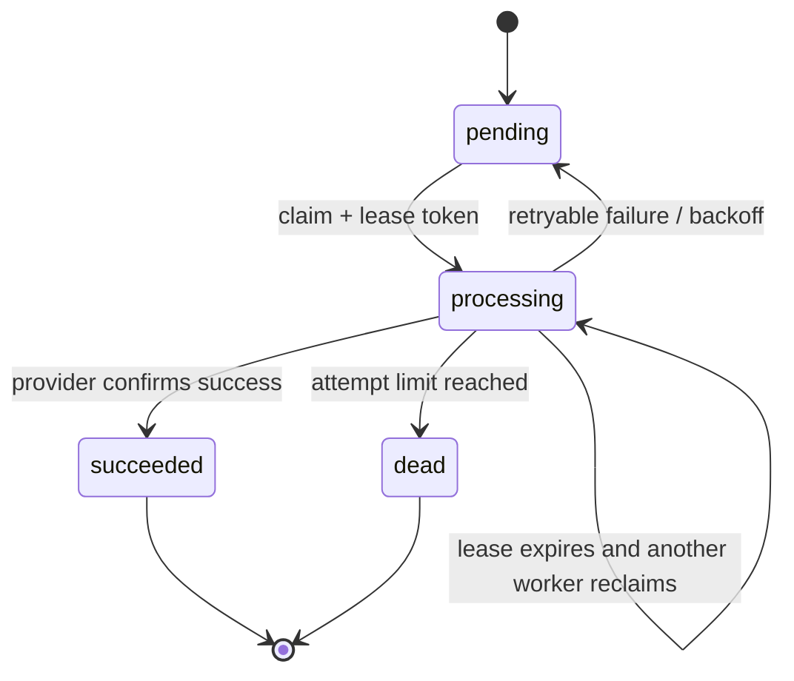

# Phase 87 — Transactional Workflow Outbox

**Status:** Phase 87.1 candidate; draft PR only  
**Scope:** durable event intent, idempotent insertion, lease-based claiming, bounded retries  
**Database target:** disposable PostgreSQL 17 during CI only  
**Production approval:** NOT GRANTED

## 1. Problem and guarantee

A workflow worker may complete a database step and then lose its process before recording that an external operation should happen. Calling a provider directly before or after an independent database update creates a dual-write gap.

The outbox narrows that gap by committing the completed step and its durable event intent in one PostgreSQL transaction. A separate dispatcher can later deliver the event.

The delivery guarantee is **at-least-once**, not exactly-once. A process can call a provider successfully and crash before recording success. The next lease owner may retry. Every future provider adapter must therefore send the stable `idempotency_key` to the provider when supported and implement reconciliation when provider idempotency is unavailable.

## 2. Data model

`private.simula_workflow_outbox` stores:
- Ownership and workflow/run/step identity.
- Step attempt generation.
- Event type, stable per-owner idempotency key and bounded JSON payload.
- `pending | processing | succeeded | dead` state.
- Delivery attempt count (maximum 8).
- Availability timestamp, random lease token and lease expiry.
- Sanitized last error and lifecycle timestamps.

The table lives in the private schema. Browser roles receive no table privileges. The RPCs are SECURITY DEFINER functions with an empty search_path and EXECUTE granted only to `service_role`.

## 3. Transaction and RPC contracts

### `simula_complete_step_with_outbox`

In one database transaction:
1. Lock and validate the current workflow run generation and owner.
2. Validate workflow and step ownership.
3. Lock the matching running step generation.
4. Mark the step succeeded and persist its output.
5. Insert the outbox event with the supplied idempotency key.
6. Return the step and event IDs.

A repeated request with the same owner/key/event/payload returns the original event. Reusing a key for a different run, step, event type or payload fails closed. A stale run/step generation cannot create an event.

### `simula_claim_workflow_outbox`

- Clamp the claim batch to 1–25.
- Claim due pending events and expired processing leases using `FOR UPDATE SKIP LOCKED`.
- Increment attempts and issue a new random lease token.
- Lease duration is 60 seconds.
- Expired events at the maximum attempt count transition to `dead`.

### `simula_finish_workflow_outbox`

- Requires the current event ID and lease token.
- Success marks the event succeeded and clears the lease.
- Failure returns it to pending with bounded exponential backoff, or dead at the maximum attempt count.
- A stale token cannot overwrite a newer lease generation.

## 4. State machine

## 5. Security and operational boundaries

- No browser-facing direct access to the private table.
- No arbitrary URL, provider credentials, headers or executable code are accepted as outbox payload instructions.
- Keep payloads minimal; do not store secrets, access tokens, payment data or raw provider responses.
- Use provider-specific allowlists and server-side credential resolution in future adapters.
- Apply request size limits, destination allowlists, per-owner quotas, rate limits and audit logging before dispatch.
- External provider calls must happen outside database transactions.
- Do not hold row locks while waiting on network I/O.
- Lease renewal and cancellation must be designed for any provider operation that can exceed 60 seconds.

## 6. Disposable CI verification

Phase 81 integration is extended with a dedicated Deno test file. It uses synthetic owner/workflow/run/step data and disposable PostgreSQL/PostgREST only.

Required assertions:
- Step completion and event insertion commit together.
- Same-key/same-payload replay returns the same event ID.
- Same key with a different payload is rejected.
- Concurrent claimers lease one event to one worker.
- A failed delivery returns to pending with backoff.
- A retry receives a new lease token and increments attempts.
- The stale token cannot finish the newer attempt.
- The current token can mark delivery succeeded.
- Replaying completion after delivery still returns the original event.

## 7. Remaining work before external actions

1. Complete exact-head Phase 81 Deno/PostgREST integration and all existing regression workflows.
2. Add lease-expiry takeover tests using controlled database time or disposable SQL fixtures.
3. Add provider adapter interfaces with strict provider allowlists, stable idempotency propagation and secret indirection.
4. Add dispatcher concurrency, rate-limit, circuit-breaker, dead-letter inspection and reconciliation tests.
5. Add outbox retention/cleanup policy and operational metrics.
6. Keep all provider adapters disabled until separately reviewed and approved.
7. Perform a staged production rehearsal only after live schema parity, secrets, RLS, rollback and human approval are established.

## 8. Release decision

This migration is a repository candidate. CI replay is not evidence that it has been applied to the connected Supabase project. No production migration, deployment, secret change, provider call, merge or activation is authorized by this PR.
